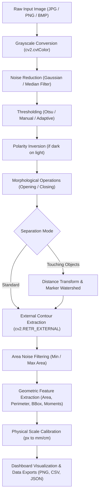

# Object Counting and Measurement Studio Using Image Processing and Computer Vision

An academic-grade, end-to-end interactive computer vision application designed for the **Image Processing and Computer Vision (IPCV) Laboratory**. 

The system accepts digital images containing multiple discrete or touching objects, executes a rigorous classical image processing pipeline (spatial filtering, global/adaptive thresholding, mathematical morphology, and marker-controlled watershed segmentation), detects and enumerates individual objects, calculates physical/image-space geometric dimensions, visualizes results with analytical charts, and exports structured reports.

[](https://www.python.org/)
[](https://opencv.org/)
[](https://streamlit.io/)
[](LICENSE)

---

## 📌 Repository and Deployment Placeholders

- **GitHub Repository URL:** `https://github.com/<your-username>/object-counting-measurement-studio` *(Replace with your actual GitHub URL)*
- **Live Streamlit Cloud URL:** `https://<your-app-name>.streamlit.app` *(Replace after deploying to Streamlit Community Cloud)*

---

## 📖 Table of Contents

1. [Problem Statement](#-problem-statement)
2. [Objectives](#-objectives)
3. [Key Features](#-key-features)
4. [IPCV Laboratory Concepts Demonstrated](#-ipcv-laboratory-concepts-demonstrated)
5. [System Architecture & Pipeline](#-system-architecture--pipeline)
6. [Mathematical Formulations](#-mathematical-formulations)
7. [Technology Stack](#-technology-stack)
8. [Project Structure](#-project-structure)
9. [Installation & Local Setup](#-installation--local-setup)
10. [Running the Application](#-running-the-application)
11. [User Guide & Workflow](#-user-guide--workflow)
12. [Automated Testing](#-automated-testing)
13. [Limitations](#-limitations)
14. [Future Scope](#-future-scope)
15. [Streamlit Cloud Deployment Guide](#-streamlit-cloud-deployment-guide)

---

## 🎯 Problem Statement

Manual visual inspection, counting, and dimensional measurement of physical objects (e.g., pharmaceutical tablets, industrial washers, coins, manufactured components, biological cultures) is labor-intensive, slow, subjective, and prone to human inspection fatigue. 

While deep learning approaches exist, they require massive annotated datasets, power-hungry GPU hardware, and lack algorithmic interpretability. In contrast, classical computer vision based on deterministic mathematical morphology, spatial filtering, and topological contour extraction provides a transparent, zero-cost, lightweight, and explainable solution ideal for university laboratory experiments and embedded quality control.

---

## 🎯 Objectives

1. **Automated Detection & Enumeration:** Automatically count discrete objects from standard photographic images (JPG, PNG, BMP) using topological contour following (`cv2.RETR_EXTERNAL`).
2. **Interactive Morphological Preprocessing:** Provide real-time UI controls for spatial smoothing (Gaussian, Median, Box), thresholding (Manual, Otsu's intra-class variance minimization, Adaptive Gaussian/Mean), and mathematical morphology (Opening, Closing, Erosion, Dilation).
3. **Advanced Clustered Object Separation:** Implement distance-transform and marker-controlled watershed segmentation to split touching or kissing convex objects.
4. **Rigorous Geometric Morphometry:** Compute image-space and calibrated physical measurements including area, perimeter, bounding box, aspect ratio, equivalent circular diameter, isoperimetric circularity, and spatial centroid coordinates.
5. **Academic Export Deliverables:** Generate downloadable high-resolution annotated images, binary segmentation masks, Pandas-compatible CSV tables, and comprehensive JSON lab reports.

---

## ✨ Key Features

- **Responsive Web Dashboard:** Built with Streamlit, optimized for high usability, readability, and immediate laboratory demonstration.
- **5 Built-in Benchmark Academic Samples:** Includes synthetic test targets (coins, geometric primitives, medicinal pills, hardware washers with central holes, touching circles).
- **Custom Image Uploader:** Supports user uploads with metadata inspection (resolution, channels, file size, memory footprint) and error handling for corrupted inputs.
- **Topological Hole Discrimination:** Properly isolates outer contours so that internal holes (e.g., washer holes) are not falsely enumerated as distinct objects.
- **Real-World Metric Calibration:** Optional spatial calibration factor ($px / \text{unit}$) allowing seamless conversion from pixels to millimeters, centimeters, or inches.
- **Interactive Statistical Visualizations:** Side-by-side pipeline inspection, intensity histogram with threshold indicators, and object area distribution bar charts.
- **Complete Suite of Automated Unit Tests:** 17 unit tests verifying filtering, thresholding, morphology, contour detection, watershed splitting, and geometric metrics.

---

## 🧪 IPCV Laboratory Concepts Demonstrated

This project maps directly onto standard university IPCV laboratory experiments:

| IPCV Experiment | Implemented Feature / Module | OpenCV / Algorithm Details |
| :--- | :--- | :--- |
| **1. Point Processing & Grayscale Conversion** | Channel luminance weighting | $Y = 0.299R + 0.587G + 0.114B$ via `cv2.cvtColor` |
| **2. Image Smoothing & Spatial Filtering** | Gaussian & Median Noise Filtering | `cv2.GaussianBlur` (2D normal kernel convolution), `cv2.medianBlur` (rank-order impulse noise rejection) |
| **3. Histogram Analysis** | Intensity distribution plotting | 256-bin pixel frequency distribution with threshold cut-off lines via Matplotlib |
| **4. Image Thresholding & Binarization** | Global, Otsu, & Adaptive Thresholding | `cv2.threshold` with `THRESH_OTSU` (minimizing $\sigma_w^2$) and `cv2.adaptiveThreshold` |
| **5. Mathematical Morphology** | Dilation, Erosion, Opening, Closing | Structuring elements via `cv2.getStructuringElement` and `cv2.morphologyEx` |
| **6. Edge & Contour Detection** | External Border Following | Topological contour tracing via Suzuki-Abe algorithm (`cv2.RETR_EXTERNAL`, `cv2.CHAIN_APPROX_SIMPLE`) |
| **7. Spatial Moments & Centroids** | Mass center calculation | Raw moments $M_{00}, M_{10}, M_{01}$ where $(\bar{x}, \bar{y}) = (M_{10}/M_{00}, M_{01}/M_{00})$ |
| **8. Touching Object Segmentation** | Distance Transform & Watershed | Euclidean distance transform `cv2.distanceTransform` + connected components markers + topological gradient flooding `cv2.watershed` |

---

## 🏗️ System Architecture & Pipeline



---

## 📐 Mathematical Formulations

### 1. Contour Area ($A$)
Calculated via Green's theorem in a discrete planar vector field:
$$A = \frac{1}{2} \left| \sum_{i=0}^{n-1} (x_i y_{i+1} - x_{i+1} y_i) \right|$$

Implemented via `cv2.contourArea(contour)`.

### 2. Contour Perimeter ($P$)
Sum of Euclidean distances between successive polygonal vertices:
$$P = \sum_{i=0}^{n-1} \sqrt{(x_{i+1} - x_i)^2 + (y_{i+1} - y_i)^2}$$

Implemented via `cv2.arcLength(contour, closed=True)`.

### 3. Circularity / Isoperimetric Quotient ($C$)
Measures compactness and circular resemblance:
$$C = \frac{4 \pi \cdot A}{P^2}$$

- Perfect circle: $C = 1.0$
- Square: $C = \frac{\pi}{4} \approx 0.785$
- Spiky or complex shapes: $C \ll 0.5$

### 4. Equivalent Circular Diameter ($D_{eq}$)
Diameter of a circle possessing the identical area as the contour:
$$D_{eq} = 2 \cdot \sqrt{\frac{A}{\pi}}$$

### 5. Spatial Centroid Coordinates $(\bar{x}, \bar{y})$
Derived from first-order spatial image moments:
$$\bar{x} = \frac{M_{10}}{M_{00}}, \quad \bar{y} = \frac{M_{01}}{M_{00}}$$
where $M_{pq} = \sum_{x} \sum_{y} x^p y^q I(x, y)$.

### 6. Physical Unit Scaling
Given a calibration scale factor $S = \frac{\text{Pixel Length}}{\text{Physical Length}}$ ($px / \text{unit}$):
- $\text{Length}_{\text{physical}} = \frac{\text{Length}_{\text{pixels}}}{S}$
- $\text{Area}_{\text{physical}} = \frac{\text{Area}_{\text{pixels}}}{S^2}$

---

## 💻 Technology Stack

- **Programming Language:** Python 3.11
- **Computer Vision Engine:** OpenCV (`opencv-python` 5.0.0+)
- **Numerical Computation:** NumPy
- **Web UI Framework:** Streamlit (1.30+)
- **Data Handling:** Pandas
- **Visualization:** Matplotlib (Agg backend) & Pillow
- **Testing Framework:** Pytest (9.1+)

---

## 📁 Project Structure

```
IPCV_Mini_Project/
├── app.py                      # Main Streamlit web application entry point
├── requirements.txt            # Python package dependencies
├── README.md                   # Comprehensive repository documentation
├── REPORT_GUIDE.md             # Complete college project report & viva guide
├── .gitignore                  # Git ignore rules for Python/caches
├── src/                        # Modular computer vision core library
│   ├── __init__.py             # Package init
│   ├── preprocessing.py        # Grayscale, smoothing, thresholding, morphology
│   ├── detection.py            # Contour extraction, area filtering, watershed
│   ├── measurement.py          # Geometric formulas, calibration, summary stats
│   ├── visualization.py        # Image annotation, bar charts, intensity histograms
│   ├── export.py               # PNG, CSV, and JSON report serializers
│   └── sample_generator.py     # Generates benchmark academic test images
├── assets/
│   └── sample_images/          # Benchmark sample images (coins, pills, washers, etc.)
│       ├── coins.png
│       ├── geometric_shapes.png
│       ├── hardware_washers.png
│       ├── pills_capsules.png
│       └── touching_objects.png
├── screenshots/
│   └── .gitkeep                # Placeholder for application UI screenshots
└── tests/                      # Automated unit test suite
    ├── __init__.py
    ├── test_preprocessing.py   # Tests for filtering, thresholding, morphology
    ├── test_detection.py       # Tests for contour counting and watershed
    └── test_measurement.py     # Tests for geometry, calibration, and exports
```

---

## ⚙️ Installation & Local Setup

### Step 1: Clone or Navigate to the Repository
```bash
git clone https://github.com/<your-username>/object-counting-measurement-studio.git
cd object-counting-measurement-studio
```

### Step 2: Create a Python Virtual Environment (Recommended)
```bash
python -m venv venv

# On Windows (PowerShell):
.\venv\Scripts\Activate.ps1

# On macOS/Linux:
source venv/bin/activate
```

### Step 3: Install Required Dependencies
```bash
pip install -r requirements.txt
```

---

## 🚀 Running the Application

Execute the Streamlit application using the local command line:

```bash
streamlit run app.py
```

Once executed, open your web browser to:
```
http://localhost:8501
```

---

## 🖥️ User Guide & Workflow

1. **Step 1 - Select Image Source:**
   - Choose one of the 5 built-in academic benchmark images from the sidebar, or upload a custom image (`JPG`, `PNG`, `BMP`).
2. **Step 2 - Configure Preprocessing:**
   - Select filter (Gaussian or Median) to reduce sensor noise.
   - Choose thresholding method (Otsu recommended for bimodal contrast).
   - If objects are dark against a light background, ensure **"Invert Polarity"** is checked.
   - Apply morphological opening to clean stray pixel noise.
3. **Step 3 - Detect & Filter:**
   - Adjust **Minimum Object Area** to filter out residual threshold speckles.
   - For touching objects (like clustered pills or coins), toggle **"Enable Watershed Segmentation"**.
4. **Step 4 - Optional Physical Calibration:**
   - Toggle **"Enable Real-World Calibration"**.
   - Input a known physical length (e.g., 20 mm coin diameter) and its measured pixel span to obtain scaled physical dimensions.
5. **Step 5 - Inspect & Export:**
   - Review the annotated result and binary mask under **Visual Inspection**.
   - Inspect tabular metrics under **Measurement Data Table**.
   - View the area bar chart and pixel intensity histogram under **Statistical Analysis**.
   - Download the annotated PNG, binary mask PNG, measurement CSV, or complete JSON report under **File Exports & Reports**.

---

## 🧪 Automated Testing

To run the complete automated test suite:

```bash
pytest -v
```

Expected result:
```
tests/test_detection.py::test_detect_contours_known_count PASSED
tests/test_detection.py::test_detect_contours_area_filtering PASSED
tests/test_detection.py::test_detect_contours_empty_mask PASSED
tests/test_detection.py::test_holes_not_counted_as_objects PASSED
tests/test_detection.py::test_segment_watershed PASSED
tests/test_measurement.py::test_measure_circle_geometry PASSED
tests/test_measurement.py::test_measure_square_geometry PASSED
tests/test_measurement.py::test_real_world_calibration PASSED
tests/test_measurement.py::test_compute_summary_statistics PASSED
tests/test_measurement.py::test_export_csv_and_json PASSED
tests/test_preprocessing.py::test_to_grayscale_valid_inputs PASSED
tests/test_preprocessing.py::test_to_grayscale_invalid_inputs PASSED
tests/test_preprocessing.py::test_apply_filter PASSED
tests/test_preprocessing.py::test_apply_threshold_manual_and_otsu PASSED
tests/test_preprocessing.py::test_apply_threshold_adaptive PASSED
tests/test_preprocessing.py::test_apply_morphology PASSED
tests/test_preprocessing.py::test_preprocess_pipeline PASSED
============================= 17 passed in 1.49s =============================
```

---

## ⚠️ Limitations

1. **Planar Assumption:** The application measures 2D planar projections. Perspective distortion from non-perpendicular camera angles will alter apparent geometric aspect ratios.
2. **Severe 3D Occlusion:** Severely overlapping objects that occlude one another cannot be fully separated using 2D distance-transform watershed alone.
3. **Lighting Uniformity:** Severe uneven illumination or directional shadows may necessitate adaptive thresholding or pre-normalization rather than standard Otsu thresholding.
4. **Calibration Homogeneity:** Physical calibration assumes an orthographic camera projection with constant depth-of-field across the object plane.

---

## 🔮 Future Scope

1. **Subpixel Edge Detection:** Integration of Canny edge subpixel interpolation for micrometer-precision industrial metrology.
2. **Ellipse & Minimum Rotated Bounding Boxes:** Fitting oriented bounding boxes (`cv2.minAreaRect`) and minimum enclosing ellipses (`cv2.fitEllipse`).
3. **Automated Checkerboard Camera Calibration:** Perspective distortion rectification using chessboard patterns (`cv2.calibrateCamera`).
4. **Color-Based Object Segmentation:** Multi-spectral clustering in HSV or Lab color spaces for distinguishing multi-colored items.

---

## ☁️ Streamlit Cloud Deployment Guide

To deploy this project online for free on Streamlit Community Cloud:

1. **Initialize Git & Push to GitHub:**
   ```bash
   git init
   git add .
   git commit -m "Initial commit: IPCV Object Counting and Measurement Studio"
   git branch -M main
   git remote add origin https://github.com/<your-username>/object-counting-measurement-studio.git
   git push -u origin main
   ```
2. **Deploy on Streamlit Community Cloud:**
   - Visit [share.streamlit.io](https://share.streamlit.io/) and log in with your GitHub account.
   - Click **"New app"**.
   - Select your repository: `<your-username>/object-counting-measurement-studio`.
   - Set the Main file path to: `app.py`.
   - Click **"Deploy!"**.
3. **Copy the Public Live URL:**
   - Once deployed, your web application will be live at `https://<your-app-name>.streamlit.app`.
   - Update the placeholder link at the top of this `README.md` and in your laboratory report.
